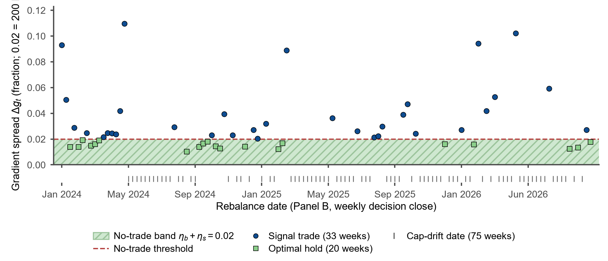
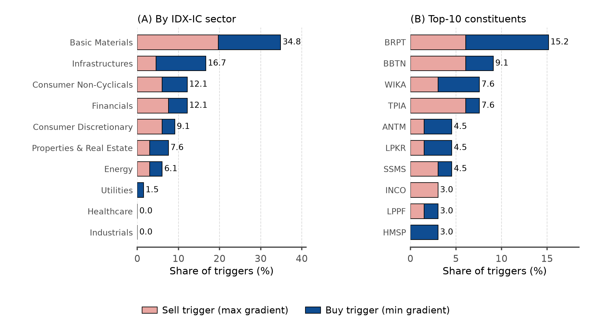

# When the Optimizer Refuses to Trade: A KKT No-Trade Zone and Lévy-Area Signal Activation under Weak Signals in LQ45 Equities

Muhammad Reihan Pandanarang¹,\*

(1) Mathematics Department, Universitas Negeri Semarang

\*Corresponding author: mrpandanarang@gmail.com

Abstrak

Portofolio mean-variance yang diseimbangkan ulang berdasarkan prakiraan yang bising dapat kehilangan sebagian imbal hasilnya karena biaya transaksi. Penelitian ini mengkaji bagaimana sinyal imbal hasil yang lemah dan dipelajari dari data melintasi pita tanpa transaksi menjadi transaksi nyata pada 40 saham LQ45 di Bursa Efek Indonesia. Jaringan bergerbang multiskala memprakirakan imbal hasil mingguan dari log-signature orde dua jalur OHLCV harian, yang luas Lévy-nya merekam urutan gerak harga-volume, lalu prakiraan masuk ke masalah mean-variance long-only berbatas dengan penalti beli dan jual asimetris sesuai biaya BEI. Uji tanpa transaksi eksplisit dari kondisi optimalitas menyatakan bahwa portofolio fisibel saat ini optimal jika dan hanya jika selisih gradien antara aset yang dapat dijual dan dibeli tidak melebihi penalti pulang-pergi. Uji ini sesuai dengan solver pada 100% dari 53 tanggal penyeimbangan fisibel interior; 75 tanggal lainnya dipaksa menyeimbang oleh drift harga yang melampaui batas bobot 15%. Transaksi yang ditolak akan kehilangan 31,39 basis poin per minggu (kumulatif 627,79 basis poin) setelah biaya, tetapi efek ini tidak signifikan (t dua sisi = -0,84; p = 0,413) pada 20 minggu yang ditolak. Rank IC ensemble sebesar 0,0332 (p satu sisi = 0,0331), sedangkan luas Lévy justru meningkatkan turnover mingguan dari 19,94% menjadi 23,08%, bukan menurunkannya. Pertahanan portofolio terhadap sinyal lemah karenanya bersifat struktural: pita biaya dari kondisi KKT, bukan prakiraan, yang menentukan kapan bertransaksi.

**Kata Kunci:** kondisi KKT; zona tanpa transaksi; log-signature; biaya transaksi; LQ45; pasar berkembang

Abstract

Rebalancing on noisy forecasts can cost a mean-variance portfolio part of its return. We study how a weak, learned return signal crosses a no-trade band into actual trades for 40 LQ45 stocks on the Indonesia Stock Exchange. A multiscale gated network forecasts weekly returns from order-2 log-signatures of daily OHLCV paths, whose Lévy areas record the order of price-volume moves, and feeds a long-only, box-constrained mean-variance problem with asymmetric buy and sell penalties tied to IDX costs. An explicit no-trade test from the optimality conditions states that a feasible current portfolio is optimal if and only if the gradient spread between sellable and buyable assets is at most the round-trip penalty. The test agrees with the solver on 100% of the 53 interior feasible rebalance dates; the other 75 dates are forced rebalances because price drift pushes a holding above the 15% cap. The declined trades would have lost 31.39 basis points per week (627.79 basis points cumulatively) after costs, but the effect is not statistically significant (two-sided t = -0.84; p = 0.413) over the 20 declined weeks. The ensemble rank IC is 0.0332 (one-sided p = 0.0331), while Lévy areas raise mean weekly turnover from 19.94% to 23.08% rather than lowering it. The defense against a weak signal is therefore structural: the cost band read from the KKT conditions, not the forecast, decides when to trade.

**Keyword:** KKT conditions; no-trade region; log-signature; transaction costs; LQ45; emerging markets

# 1. INTRODUCTION

Mean-variance optimization remains the reference framework for portfolio construction [1], yet it is notoriously fragile in practice. Because the optimizer treats estimated expected returns as if they were true, it systematically overweights assets whose returns are overestimated, a behavior Michaud termed error maximization [2]; the problem is severe enough that the naive equally weighted portfolio is difficult to beat out of sample [3]. This fragility becomes costly once trading is not free. Each revision of the forecasts can move the optimal weights, and every move incurs a cost that is certain, whereas the benefit of the revised forecast is not. On the Indonesia Stock Exchange (IDX), the certain part is substantial: a typical retail broker charges 0.15% on purchase and 0.25% on sale, a 0.40% round trip of which 0.1% is the final income tax on sales [4, 5]. Consequently, a portfolio that rebalances weekly on noisy forecasts can lose a material share of its return to trading alone.

Every such rebalancing decision passes through four ingredients in sequence: the market history that is observed, the beliefs about returns and risk estimated from it, the rule that maps these beliefs to portfolio weights, and the friction of moving from the current portfolio to the new one. Research on this problem can be organized into four lines by the ingredient each improves.

The first line changes how market history is represented. The signature of a path, a central object in rough path theory [6, 7], summarizes a multivariate time series through its iterated integrals. At order two, the log-signature reduces to the path increments and the Lévy areas: signed areas that record whether one coordinate moves before or after another, for example whether a surge in volume precedes or follows a price move [7]. Signature portfolios can uniformly approximate path-dependent portfolio functions [8], signature-based trading extends the mean-variance framework to path-dependent signals [9], and randomized signatures estimate drifts for portfolio selection [10].

The second line takes this representation as given and improves the beliefs estimated from it. Shrinkage estimators stabilize the covariance matrix [11], and machine-learning models extract return signals from large feature sets; even so, equity returns have a very low signal-to-noise ratio, and the best models achieve only modest predictive accuracy [12]. Worse, forecasting models trained on weakly predictable targets can collapse toward the cross-sectional mean, which motivates losses that combine calibration with cross-sectional ranking [13].

Because beliefs remain noisy however they are estimated, the third line makes the decision rule itself less sensitive to estimation error. Robust formulations optimize over uncertainty sets that correspond to confidence regions for the estimated parameters [14], norm constraints on the portfolio-weight vector help portfolios perform well out of sample [15], and decision-focused learning trains forecasting models on the error of the decisions they induce rather than on prediction error [16].

The fourth line acts on friction and controls trading directly. Penalizing turnover in the objective is equivalent to a form of regularization that reduces the impact of estimation error [17, 18]. With predictable returns and quadratic trading costs, the optimal policy trades only partially toward an aim portfolio that weights signals by their persistence [19], whereas proportional costs create a no-trade region, in which holding the current portfolio is optimal [20, 21].

These four lines have developed largely in parallel. In recent signature-based and machine-learning portfolio studies, for example, the decision of when to trade is delegated to a cost term or a chosen threshold rather than characterized [8, 10]. Such a characterization is within reach: whether holding the current portfolio is optimal can be read from standard subdifferential optimality conditions [22, 23]. Closely related no-trade characterizations exist for mean-variance rebalancing with transaction costs [20], multiperiod portfolios with general costs [21] and convex formulations and algorithms for transaction-cost portfolio problems [24, 25], and the two-threshold (violating-pair) optimality condition of sequential minimal optimization (SMO) is an analogue outside finance [26]. What is missing is an explicit, directly computable specialization to the fully invested, long-only, box-constrained case without a risk-free asset, used as a per-date diagnostic. Without such a diagnostic, it remains unclear how a weak, learned return signal crosses a no-trade band into actual trades: a forecast that is statistically indistinguishable from noise may still generate substantial turnover, or none at all. Answering it requires reading, at each rebalance date, whether the forecast or the risk model drives the decision to trade, and whether the trades that are declined would have paid for their costs.

The Indonesian literature has not yet reached this question: LQ45 portfolio studies form Markowitz allocations from historical returns [27, 28] or pass LSTM/BiLSTM price forecasts built on technical-indicator inputs to a Markowitz model without turnover or cost terms [29], while IDX forecasting studies apply deep-learning models to price data [30] and volume-based technical indicators to LQ45 returns [31]. To our knowledge, no IDX study encodes the joint, order-dependent price–volume path, for example through Lévy areas, or links such features to a cost-aware mean-variance allocation.

We address these gaps in a setting where the return signal is weak. A compact multiscale gated network forecasts weekly returns for 40 LQ45 constituents from order-2 log-signatures of daily OHLCV paths over 5-, 20- and 60-day windows and is trained with a loss that balances calibration and ranking. The forecasts feed a long-only, box-constrained mean-variance problem with a Ledoit–Wolf covariance [11] and asymmetric buy and sell turnover penalties tied to the IDX purchase and sale costs. Rather than asking whether the signal beats the market, we ask which components of this pipeline protect the investor from trading on noise, and we answer it through the optimality conditions of the problem itself.

Answering this question yields three contributions. (i) We state an explicit, multiplier-free no-trade test for the turnover-penalized problem under budget and box constraints: a feasible current portfolio is optimal if and only if the largest gradient component among assets that can be sold exceeds the smallest among assets that can be bought by at most the round-trip cost $\eta_{b} + \eta_{s}$. The test follows from standard subdifferential optimality conditions [22, 23] and shares the structure of the violating-pair condition of SMO [26]; we use it as a per-date diagnostic and verify it against the solver at every interior feasible rebalance date, while logging cap-drift dates separately because they lie outside the theorem.

(ii) We introduce the signal-activation ratio $\psi_{\kappa}$, the share of interior feasible rebalance dates on which the gradient spread crosses this threshold, and compare it with a constant-forecast benchmark; the gap measures how much of the trading the forecast itself drives and thereby links forecast collapse to realized trading.

(iii) We test whether path-order features dampen the turnover induced by the trading signal, using an ablation that removes the Lévy areas, a decomposition of the constituents that trigger trades and a two-panel out-of-sample evaluation with deflated Sharpe ratios [32], in which all learned baselines share the same loss and penalty. The ablation rejects the damping hypothesis: Lévy areas raise turnover, so the defense against noise is structural rather than representational. Section 2 describes the methods, Section 3 presents and discusses the results, and Section 4 concludes.

# 2. METHODOLOGY

## 2.1 Data and sample

The sample consists of 40 stocks selected from the constituents of the LQ45 index of the Indonesia Stock Exchange. Daily open, high, low and close prices and volume (OHLCV) are downloaded once from Yahoo Finance (`auto_adjust=False`) for 2 January 2017 to 1 October 2026, the last trading day before the exclusive end bound of 2 October 2026. Open, high, low and close are scaled by `Adj Close / Close` so that dividends and splits do not introduce artificial jumps in the path geometry, while volume is left as reported. The raw snapshot is archived with a SHA-256 manifest and never patched. Across the aligned exchange calendar, missing or suspended stock-days carry forward the last adjusted price ($\Delta\log P = 0$) and set volume to zero; they are never filled from later dates.

The universe follows a rule computed from the data rather than a typed list. From the 53 LQ45 constituents appearing in the official February–July 2017 and August 2017–January 2018 review periods, two lack a price snapshot in the raw feed (`SRIL.JK`, `WSKT.JK`), leaving 51 candidates. We keep the 40 stocks with the largest median daily trading value (`Close × Volume`) over calendar year 2017 among those with a complete history to 1 October 2026, operationally a first observation on or before 10 January 2017, a last observation within 35 days of 1 October 2026, and at least 150 trading days in 2017. The ranking uses only information available before the first training date, whereas the completeness requirement conditions on survival, a limitation we return to in Section 4.2. The 2017 data serve only this ranking; features and training start in 2018.

Portfolios are rebalanced weekly, every five trading days. At the close of a decision date $t$ the model forecasts, for each stock $i$, the five-day log return $y_{t,i} = \log\left( P_{t + 6,i}/P_{t + 1,i} \right)$ earned by a position opened at the close of $t + 1$ and held over days $t + 2$ to $t + 6$, so the target never includes the execution day. Starting from calendar partitions for a warm-up period (2 January to 27 March 2018) that fills the longest feature window, a training period (28 March 2018 to 30 June 2023), a validation period (3 July to 29 December 2023) and a test period (from 2 January 2024), we purge the last six decision days of the training and validation partitions, eliminating five-day labels that overlap the next partition, and enforce an additional six-trading-day embargo at the start of the validation and test partitions, a 12-trading-day total separation. The resulting effective decision-date windows are: training from 28 March 2018 to 19 June 2023 (1,300 trading days), validation from 11 July to 19 December 2023 (113 trading days), Panel A (test) from 10 January 2024 to 30 December 2025 (467 decision days, 94 weekly rebalances), and Panel B (full out-of-sample, adding the 2026 continuation) from 10 January 2024 to 23 September 2026 (638 decision days, 128 weekly rebalances, with final five-day holding returns realized through 1 October 2026); both panels come from one continuous run (Section 2.9).

## 2.2 Transaction-cost model

Exchange, clearing and settlement fees and the guarantee-fund contribution levied by IDX, KPEI and KSEI total 0.0433% of traded value per side including value-added tax [33]; sales also carry the 0.1% final income tax [4]. Online retail brokers quote about 0.15% on purchases and 0.25% on sales [5, 34], and some state that these rates include the commission, its value-added tax and the charges above [34]; we therefore set $c_{b} = 0.0015$ and $c_{s} = 0.0025$. A broker quoting these rates before fees would charge about 0.19% and 0.29%, a case covered by the cost-level sensitivity in Section 3.7. Costs are charged on traded value at execution (close of $t + 1$) and booked on the first holding day; spread, market impact and stamp duty are excluded (Section 4.2).

## 2.3 Order-2 log-signature features and Lévy areas

The following subsections follow the rebalancing chain of Section 1, from the information the model observes to the rule that turns beliefs into trades. Each stock's market history enters as a five-channel path: on every trading day the channels are $x = \left( \log O,\log H,\log L,\log C,\log(1 + V) \right)$, and for each window length $W \in \left\{ 5,20,60 \right\}$ days the most recent $W + 1$ observations are joined into a $W$-segment piecewise-linear path $X:\lbrack 0,W\rbrack \rightarrow \mathbb{R}^{5}$. Its order-2 log-signature consists of the five increments $X_{W}^{i} - X_{0}^{i}$ and the ten Lévy areas [7]

$$
A^{ij} = \frac{1}{2}\sum_{k=0}^{W-1}\left\lbrack \left( X_{k}^{i} - X_{0}^{i} \right)\Delta X_{k}^{j} - \left( X_{k}^{j} - X_{0}^{j} \right)\Delta X_{k}^{i} \right\rbrack,\quad 1 \leq i < j \leq 5 \tag{1}
$$

where $\Delta X_{k} = X_{k+1} - X_{k}$; for a piecewise-linear path this is an exact finite sum over its segments. An increment records how far a channel moved over the window; a Lévy area records the order of the moves, since $A^{ij}$ is positive when moves in channel $i$ tend to precede moves in channel $j$ and negative in the opposite order. For the close–volume pair, its sign separates a volume surge that precedes a price move from one that follows it, which two paths with identical increments cannot tell apart. Because suspended or missing stock-days retain carried-forward prices ($\Delta X_k^i = 0$ for $i \le 4$) and set $V = 0$ ($\log(1+V) = 0$), resumption of trading generates transient step changes in the volume channel and the price–volume areas $A^{i5}$; we note suspension masking as a microstructure refinement in Section 4.2. Each window yields 15 coordinates and the three windows 45 features, standardized per feature with the mean and standard deviation pooled across stock-day observations of the training period only. The increments-only ablation LogSig-Inc keeps the 15 increments and drops the 30 Lévy areas (Section 2.8).

## 2.4 Multiscale gated network and composite loss

Beliefs about returns come from a compact multiscale gated network (MSGN). The 15 coordinates $z^{(W)}$ of each window pass through their own branch $h_{W} = \operatorname{ReLU}\left( U_{W}z^{(W)} + c_{W} \right) \in \mathbb{R}^{16}$, a gate $\omega = \operatorname{softmax}\left( U_{g}z + c_{g} \right)$ computed from all 45 features weights the three scales, and a linear head returns the forecast

$$
\hat{y} = a^{\top}\sum_{W}\omega_{W}h_{W} + b \tag{2}
$$

The network has 923 parameters shared across the 40 stocks, and its gate weights $\omega_{W}$ show which time scale drives the forecast (Section 3.1). The model forecasts the five-day log return, $\hat{y}_{t,i}$, and the corresponding simple return is $\mu_{t,i} = \exp\left( {\hat{y}}_{t,i} \right) - 1$. Training minimizes a composite loss that balances calibration and cross-sectional ranking, in the spirit of losses designed against forecast collapse [13]:

$$
\mathcal{L}(\theta) = \operatorname{NMSE}(\theta) + \lambda_{rank}\frac{1}{\left| \mathcal{B} \right|}\sum_{t \in \mathcal{B}}\left( 1 - \rho\left( u_{t},v_{t} \right) \right) \tag{3}
$$

where NMSE is the mean squared error divided by the training variance of the target, $\rho$ is the Pearson correlation across stocks on date $t$, $u_{t}$ and $v_{t}$ are the cross-sectional z-scores of forecasts and targets clipped to $\lbrack - 3,3\rbrack$, $\mathcal{B}$ is a mini-batch of 32 trading days sampled without replacement across the 1,300 training dates at each epoch and retaining all 40 stocks ($32 \times 40 = 1{,}280$ stock-day observations), and $\lambda_{rank} = 1$. This term is a differentiable ranking surrogate; the reported empirical ranking metric in Section 2.10 remains the cross-sectional Spearman correlation. Optimization uses AdamW with weight decay $10^{- 4}$ for at most 30 epochs; learning rates $10^{- 3}$ and $3 \times 10^{- 4}$ are compared on validation for LogSig and MLP (LogSig-Inc and LSTM train at $10^{- 3}$ throughout), with the comparison run on the first seed and the selected rate shared by all five seeds. Early stopping with patience 8 keeps the checkpoint that minimizes $S = \mathcal{L}_{val} - 0.5\,\overline{IC} + 10\left( 1 - \overline{IC} \right)\mathbf{1}\left\{ \overline{IC} \leq 0 \right\}$, where $\overline{IC}$ is the mean daily validation rank IC and the last term rejects checkpoints whose rank IC is not positive. The selected weights are frozen, nothing is refitted in the test period, and every model is trained with five pinned seeds, 0 to 4.

## 2.5 Covariance estimation and the turnover-penalized mean-variance problem

Beliefs about risk come from the Ledoit–Wolf shrinkage estimator [11] applied to the previous 60 daily returns and scaled to the five-day horizon, $\Sigma_{t} = 5\,{\hat{\Sigma}}_{t}^{LW} + 10^{- 12}I$. The forecasts are shrunk toward their cross-sectional mean, ${\tilde{\mu}}_{t} = (1 - \alpha)\mu_{t} + \alpha{\bar{\mu}}_{t}\mathbf{1}$ with $\alpha = 0.5$. This keeps their ranking and halves their dispersion, and because a common term cancels under full investment it is equivalent to shrinking the forecast deviations toward zero; we disclose it because it narrows the gradient spread of Section 2.6 and so enters every trade decision. Given the weights $w^{-}$ held at the close of $t$, the portfolio solves

$$
\min_{w}\; - w^{\top}\tilde{\mu} + \frac{\gamma}{2}w^{\top}\Sigma w + \eta_{b}\mathbf{1}^{\top}\left( w - w^{-} \right)^{\text{+}} + \eta_{s}\mathbf{1}^{\top}\left( w^{-} - w \right)^{\text{+}} \tag{4}
$$

$$
\text{s.t.}\quad\mathbf{1}^{\top}w = 1,\quad 0 \leq w \leq w_{\max} \tag{5}
$$

with risk aversion $\gamma = 2.5$, cap $w_{\max} = 0.15$ and penalties $\eta_{b} = \kappa c_{b}$ and $\eta_{s} = \kappa c_{s}$ proportional to the purchase and sale costs of Section 2.2. The primary scale $\kappa = 5$ gives $\eta_{b} = 0.0075$ and $\eta_{s} = 0.0125$: penalizing turnover beyond the cost itself acts as a form of regularization that reduces the impact of estimation error [17, 18], and Section 3.7 varies $\kappa$. Stacking $x = (w, u^{+}, u^{-}) \in \mathbb{R}^{3N}$ ($3N = 120$) under the linear equality constraints $\mathbf{1}^{\top}w = 1$ and $w - u^{+} + u^{-} = w^{-}$ with box bounds $0 \leq w \leq w_{\max}$ and $u^{+}, u^{-} \geq 0$, initialized at $(w^{-}, \mathbf{0}, \mathbf{0})$, turns (4)–(5) into a smooth convex quadratic program solved by SLSQP with function tolerance $10^{- 12}$ and at most 200 iterations. A relaxation ladder and a ridge-regularized fallback engage only if the first attempt fails to converge, and on cap-drift dates the warm start is projected onto the feasible box; neither changes the optimum.

## 2.6 Theorem 1: the no-trade test and its role

Whether the optimizer trades at date $t$ can be read from (4)–(5) before the problem is solved. Let $g = - \tilde{\mu} + \gamma\Sigma w^{-}$ be the gradient of the smooth part of the objective at the current weights, $J = \left\{ j:w_{j}^{-} > 0 \right\}$ the assets that can be sold and $I = \left\{ i:w_{i}^{-} < w_{\max} \right\}$ the assets that can be bought; both sets are non-empty because $\mathbf{1}^{\top}w^{-} = 1$ and $Nw_{\max} > 1$.

*Theorem 1 (no-trade test).* Let $w^{-}$ satisfy (5). Then holding $w^{-}$ is optimal for (4)–(5) if and only if

$$
\Delta g_{t} = \max_{j \in J}g_{j} - \min_{i \in I}g_{i} \leq \eta_{b} + \eta_{s} \tag{6}
$$

The proof in Appendix A writes the optimality condition with the subdifferential of the trading cost and eliminates the budget multiplier. Its economics is a single pair trade: selling a small amount $\epsilon$ of asset $j$ and buying the same amount of asset $i$ changes the smooth objective by $\epsilon\left( g_{i} - g_{j} \right)$ and the penalty by $\epsilon\left( \eta_{b} + \eta_{s} \right)$, so the trade pays exactly when $g_{j} - g_{i}$ exceeds the round-trip penalty, and the best pair sets the largest gradient among sellable assets against the smallest among buyable ones. The band $\eta_{b} + \eta_{s} = \kappa\left( c_{b} + c_{s} \right)$ equals 0.02 at $\kappa = 5$ and widens linearly in $\kappa$, so for given current weights a no-trade date at one penalty scale remains one at every larger scale.

Theorem 1 is not a new theorem. It is an explicit, multiplier-free specialization of standard subdifferential optimality conditions [22, 23] to full investment without a risk-free asset, long-only box limits and asymmetric costs, closely related to the no-trade characterizations in [20, 21], to the optimality conditions used by algorithms for transaction-cost portfolio problems [25] and to the violating-pair condition of SMO [26] (Appendix A.3). Its role here is diagnostic. At every interior feasible rebalance date we record $\Delta g_{t}$, the margin $\Delta g_{t} - \left( \eta_{b} + \eta_{s} \right)$ and the assets attaining the maximum and minimum, and compare the verdict of (6) with the solver's, counting a date as traded when the solver's two-sided weight change $\lVert w_{t} - w_{t}^{-} \rVert_{1}$ exceeds the fixed execution tolerance $\tau_{\mathrm{tol}} = 10^{- 4}$ (1 bp) from the configuration. Dates with a margin below $10^{- 6}$ in absolute value are reported separately as boundary cases, because there the verdict depends on solver tolerance. Dates on which price drift pushes at least one holding above $w_{\max}$ render $w^{-}$ infeasible for (5) and force a rebalancing trade outside the assumptions of Theorem 1; such dates are logged separately as cap-drift forced trades in Table 3. In the production run the solver is short-circuited on interior hold dates for speed; a full re-run with the short-circuit disabled reproduces the solver's decision on every one of the 128 rebalance dates, so the agreement of Table 3 does not depend on skipping the QP on holds.

## 2.7 Signal-activation ratio $\mathbf{\psi}_{\mathbf{\kappa}}$: what it measures

Theorem 1 classifies single interior feasible dates; the signal-activation ratio summarizes them over a backtest. For penalty scale $\kappa$ and the subset $\mathcal{R}_{\mathrm{int}} = \left\{ t \in \mathcal{R} : w_{t}^{-} \leq w_{\max} \right\}$ of interior feasible rebalance dates, excluding cap-drift dates on which $w_{t}^{-}$ violates (5) and rebalancing is mechanically forced outside Theorem 1,

$$
\psi_{\kappa} = \frac{1}{\left| \mathcal{R}_{\mathrm{int}} \right|}\sum_{t \in \mathcal{R}_{\mathrm{int}}}\mathbf{1}\left\{ \Delta g_{t} > \eta_{b} + \eta_{s} \right\} \tag{7}
$$

is the share of interior feasible dates on which the gradient spread crosses the band, computed from the backtest run at that $\kappa$, because the current weights, and with them both $\mathcal{R}_{\mathrm{int}}$ and $\Delta g_{t}$, depend on the penalty. On its own $\psi_{\kappa}$ does not measure signal strength but the balance of forecast and risk pressure against cost: a collapsed forecast, ${\tilde{\mu}}_{i} \approx \bar{m}$ for every $i$, shifts all gradient components equally and cancels in the spread, leaving $\gamma\Sigma w^{-}$, which still moves as prices drift the weights. We therefore compare $\psi_{\kappa}$ with $\psi_{\kappa}^{0}$ from a risk-only benchmark: the same backtest with a constant forecast ($\mu = 0$, since any common value cancels) and the same $\gamma$, $\Sigma$, cap, penalties and costs, run once for each $\kappa$; at $\kappa = 5$ it coincides with the penalized GMV baseline of Section 2.8. The gap $\psi_{\kappa} - \psi_{\kappa}^{0}$, read as a curve over $\kappa$, is the forecast-collapse indicator. A gap near zero means that collapse has reached the trades, and a positive gap is the share of interior rebalance dates on which the forecast, not the risk model, carries the spread across the band; no cutoff is imposed.

## 2.8 Baselines and apples-to-apples protocol

All strategies share the covariance estimator, cap, costs, execution timing and initial portfolio, so that differences come from the beliefs or the decision rule alone. Four learned models share the composite loss, training protocol, seeds, $\alpha$ shrinkage and penalized problem of Sections 2.4 and 2.5: the full model, called LogSig below (MSGN on all 45 features); LogSig-Inc, the same architecture on the 15 increments (353 parameters), which isolates the nonlinear order-2 Lévy areas; an MLP with one hidden layer of 32 units on the 45 features (1,505 parameters), isolating multiscale gating; and an LSTM with 32 hidden units on the raw sequence of the last 60 daily log returns (4,513 parameters), a sequential baseline without path-signature compression. Unlike the 45 log-signature coordinates, which are z-scored across training stock-days, the LSTM ingests unstandardized daily log returns (magnitude $\sim 10^{-2}$), an intentional raw-return specification whose input scale contributes to its compressed forecast dispersion in Section 3.2. Three classical strategies complete the comparison. Hist-MV replaces the forecast with the mean of the previous 60 daily returns scaled to five days, shrunk with the same $\alpha = 0.5$, in two variants: unpenalized ($\eta_{b} = \eta_{s} = 0$, costs still charged) and with the primary penalty ($\eta_{b} = 0.0075$, $\eta_{s} = 0.0125$). GMV sets $\mu = 0$ and solves (4)–(5) with the same penalty, so it is minimum variance under the same friction; the unpenalized GMV appears only as a supplementary row. EW rebalances weekly to $1/N$ at the same costs, a benchmark that is difficult to beat out of sample [3].

## 2.9 Backtest protocol, two panels and metrics

Each strategy is simulated in one continuous run from 10 January 2024 to 1 October 2026, across the 128 post-embargo rebalance decision dates starting 10 January 2024, initialized at $w^{-} = \mathbf{1}/N$ with any first-rebalance trade cost charged. At the close of decision date $t$ the optimizer sees $w_{t}^{-}$, the holdings drifted to that close, and chooses the target weight vector $w_{t}$; the trade executes at the close of $t + 1$. Between rebalances the weights drift with prices,

$$
w_{u + 1,i} = \frac{w_{u,i}\left( 1 + R_{u,i} \right)}{\sum_{k}w_{u,k}\left( 1 + R_{u,k} \right)} \tag{8}
$$

where $R_{u,i}$ is the simple return of stock $i$ on day $u$, and the cost

$$
C_{t + 1} = c_{b}\mathbf{1}^{\top}\left( w_{t} - w_{t + 1}^{d} \right)^{\text{+}} + c_{s}\mathbf{1}^{\top}\left( w_{t + 1}^{d} - w_{t} \right)^{\text{+}} \tag{9}
$$

is charged against the holdings $w_{t + 1}^{d}$ drifted through day $t + 1$, the weights actually held at execution, and booked on the first holding day $t + 2$. The QP and the KKT log thus use the weights the optimizer saw at $t$, while execution moves the drifted holdings $w_{t + 1}^{d}$ directly to the target $w_{t}$ rather than applying fixed active weight increments $\Delta w_{t} = w_{t} - w_{t}^{-}$; targeting $w_{t}$ guarantees that post-trade holdings at $t + 1$ satisfy full investment and never breach the box cap. Conversely, on a hold date, when $\lVert w_{t} - w_{t}^{-} \rVert_1 \leq \tau_{\mathrm{tol}} = 10^{-4}$, no order is sent at $t + 1$, (9) is not applied ($C_{t + 1} = 0$), and holdings continue to drift passively through the holding window. The position is held over days $t + 2$ to $t + 6$, matching the forecast target of Section 2.1. Panel A is the prefix of this same continuous run, cut by rebalance cycle rather than by decision date, so its return window spans $94 \times 5 = 470$ trading days and covers the full holding period of its final rebalance. Within each panel, rebased at its start, net daily returns give the net compound annual growth rate (CAGR), the annualized Sharpe ratio in excess of a constant risk-free rate of 6% per year over 252 trading days, the maximum drawdown (MDD) and the mean per-rebalance two-sided executed turnover (a weekly rate, not annualized), computed from the executed weight movement $\lVert w_{t} - w_{t + 1}^{d} \rVert_1$, which is zero on hold dates. Headline tables report the mean and standard deviation across the five seeds; per-seed results are kept in the repository.

## 2.10 Statistical inference

Predictive content is the rank information coefficient (rank IC), the cross-sectional Spearman correlation across the $N = 40$ stocks between forecasts and realized five-day returns. In Table 1 and Section 3.1, out-of-sample rank IC is evaluated on the weekly rebalance decision dates ($n_{\mathrm{reb}} = 94$ in Panel A, $128$ in Panel B), where consecutive five-day return windows $[t+2, t+6]$ are strictly non-overlapping; the one-sided $t$-test of a non-positive mean rank IC therefore uses the exact sample size $n_{\mathrm{reb}}$ and $\mathrm{df} = n_{\mathrm{reb}} - 1$ ($\mathrm{df} = 127$ in Panel B). When rank IC is evaluated across all daily decision dates ($n = 638$ in Panel B, as also monitored during validation checkpointing), consecutive five-day targets overlap and the $t$-test scales the sample size to $n_{\mathrm{eff}} = n/5$ ($\mathrm{df} = n/5 - 1 = 126.6$); both per-seed and seed-averaged ensemble statistics are tracked. Risk-adjusted performance against EW is the intercept of a regression of daily net returns on the benchmark's net returns, with Newey–West standard errors using Bartlett weights and $L = 5$ lags [35]. Because many configurations are evaluated, Sharpe ratios are deflated [32]: the deflated Sharpe ratio is the probability that the true Sharpe ratio exceeds the maximum expected among $M$ unskilled trials, adjusted for skewness, kurtosis and sample length, with the cross-trial variance of Sharpe ratios taken over the same panel.

We count $M = 1{,}225$ trials. The sensitivity grid crosses $\gamma \in \left\{ 1,2.5,5,10 \right\}$, $\kappa \in \left\{ 0,1,2.5,5,10 \right\}$ and a cost multiplier $m \in \left\{ 0.5,1,2 \right\}$ that scales costs and penalties together ($c_{b} = 0.0015m$, $c_{s} = 0.0025m$, $\eta_{b} = \kappa c_{b}$, $\eta_{s} = \kappa c_{s}$) for four models and five seeds (1,200 trials); the non-inclusive cost case of Section 2.2 ($c_{b} = 0.001933$, $c_{s} = 0.002933$) adds 20, and the four classical strategies and the unpenalized GMV add five. The risk-only benchmark runs are diagnostics and are not counted. The deflated Sharpe ratio of every row uses the seed-averaged return series for learned models and the single run for classical strategies, and is deflated against all $M = 1{,}225$ trials. All parameters live in versioned configuration files, seeds and dependencies are pinned, and the raw data snapshot is archived as a versioned release asset whose SHA-256 hash every step verifies; the pipeline regenerates every table and figure from it, and the repository README maps each table and figure to its source (<https://github.com/raindragon14/Stillwater>, release `v2.0.0`). The Markdown source of this manuscript is versioned separately in the present repository.

# 3. RESULT AND DISCUSSION

## 3.1 Predictive content of the signal

We first establish how weak the signal is. Table 1 reports the mean rank IC of each forecasting strategy in both panels. On the non-overlapping weekly rebalance dates, LogSig attains $+0.0224 \pm 0.0188$ in Panel A ($n_{\mathrm{reb}} = 94$) and $+0.0231 \pm 0.0187$ in Panel B ($n_{\mathrm{reb}} = 128$), while the seed-averaged ensemble forecast attains $+0.0332$ (cross-date s.d. $0.2027$, $\mathrm{df} = 127$, one-sided $t = 1.85$, $p = 0.0331$). Evaluated across all $n = 638$ overlapping daily decision dates with effective sample size $n_{\mathrm{eff}} = 127.6$ ($\mathrm{df} = 126.6$), the same ensemble attains $+0.0278$ (s.d. $0.1898$, one-sided $t = 1.65$, $p = 0.0503$), just outside the 5% threshold. At the 5% level, the ensemble rejects a non-positive mean rank IC for LogSig ($p = 0.0331$) and MLP ($p = 0.0005$), but not for LogSig-Inc ($p = 0.0634$) or LSTM ($p = 0.2606$); per-seed means and standard deviations are in Table 1 and the repository. The signal is therefore weak but not absent for the full model, and Sections 3.3–3.6 are read with this caveat. The gate weights of LogSig average $\omega_{5} = 0.342$, $\omega_{20} = 0.355$ and $\omega_{60} = 0.303$, so the three scales are balanced, with the 20-day branch marginally dominant; the gate does not collapse to a single lookback window. The rest of this section asks what the pipeline does with a signal of this strength.

**Table 1. Out-of-sample performance, Panels A and B (learned models: mean ± s.d. over five seeds; classical strategies are point estimates)**

<!-- BEGIN TABLE 1 -->
| Strategy | Net CAGR | Sharpe | MDD | Turnover | Rank IC | NW alpha vs EW | Deflated Sharpe |
|:---|---:|---:|---:|---:|---:|---:|---:|
| **Panel A (test 2024–2025)** |  |  |  |  |  |  |  |
| LogSig | 23.59% ± 6.85% | 0.74 ± 0.23 | 28.10% ± 6.36% | 20.36% ± 2.22% | +0.0224 ± 0.0188 | +9.35% (t=1.37) | 0.2802 |
| LogSig-Inc | 19.58% ± 7.85% | 0.63 ± 0.29 | 24.92% ± 4.56% | 17.41% ± 7.72% | +0.0044 ± 0.0213 | +6.46% (t=0.79) | 0.2301 |
| MLP | 23.93% ± 12.21% | 0.79 ± 0.45 | 26.49% ± 9.37% | 29.44% ± 13.30% | +0.0146 ± 0.0183 | +10.22% (t=1.77) | 0.3057 |
| LSTM | 10.97% ± 0.00% | 0.34 ± 0.00 | 26.31% ± 0.00% | 0.00% ± 0.00% | +0.0114 ± 0.0146 | -1.11% (t=-0.44) | 0.1303 |
| Hist-MV, penalized | 8.90% | 0.23 | 28.84% | 1.98% | -0.0122 | -2.21% (t=-0.31) | 0.1004 |
| Hist-MV, unpenalized | 33.45% | 1.08 | 16.88% | 44.86% | -0.0122 | +19.33% (t=1.63) | 0.4543 |
| GMV | 10.97% | 0.34 | 26.31% | 0.00% | – | -1.11% (t=-0.44) | 0.1303 |
| EW | 12.87% | 0.42 | 26.49% | 3.52% | – | – | 0.1571 |
| GMV, unpenalized (supplementary) | 0.43% | -0.33 | 23.39% | 22.59% | – | -8.04% (t=-1.86) | 0.0202 |
| **Panel B (full out-of-sample, incl. the 2026 continuation)** |  |  |  |  |  |  |  |
| LogSig | 6.64% ± 6.11% | 0.15 ± 0.21 | 35.61% ± 5.26% | 23.08% ± 2.48% | +0.0231 ± 0.0187 | +7.48% (t=1.16) | 0.0526 |
| LogSig-Inc | 7.70% ± 4.72% | 0.18 ± 0.18 | 31.89% ± 6.61% | 19.94% ± 9.03% | +0.0122 ± 0.0184 | +8.28% (t=1.11) | 0.0571 |
| MLP | 11.77% ± 6.85% | 0.33 ± 0.25 | 29.92% ± 8.84% | 32.97% ± 14.60% | +0.0303 ± 0.0127 | +11.88% (t=2.12) | 0.0906 |
| LSTM | -1.66% ± 0.00% | -0.27 ± 0.00 | 32.89% ± 0.00% | 0.00% ± 0.00% | +0.0075 ± 0.0079 | -1.73% (t=-0.71) | 0.0108 |
| Hist-MV, penalized | -4.78% | -0.36 | 35.89% | 2.01% | -0.0010 | -4.40% (t=-0.66) | 0.0073 |
| Hist-MV, unpenalized | 12.12% | 0.34 | 30.21% | 45.48% | -0.0010 | +12.70% (t=1.18) | 0.0956 |
| GMV | -1.66% | -0.27 | 32.89% | 0.00% | – | -1.73% (t=-0.71) | 0.0108 |
| EW | 0.11% | -0.19 | 30.20% | 3.64% | – | – | 0.0154 |
| GMV, unpenalized (supplementary) | -3.33% | -0.56 | 23.39% | 22.60% | – | -3.71% (t=-0.89) | 0.0028 |
<!-- END TABLE 1 -->

*Notes:* Turnover is the mean per-rebalance two-sided executed turnover (a weekly rate, not annualized). Rank IC is the cross-sectional Spearman correlation on weekly rebalance dates; NW alpha is annualized against EW; the deflated Sharpe ratio uses all $M = 1{,}225$ trials. Classical strategies are single runs and therefore have no cross-seed standard deviation.

## 3.2 Out-of-sample performance, Panels A and B

Table 1 also compares all strategies on identical metrics. In Panel B, LogSig delivers a net CAGR of $6.64\% \pm 6.11\%$ and a Sharpe ratio of $0.15 \pm 0.21$, with a Newey–West alpha of $+7.48\%$ ($t = 1.16$) over EW and a deflated Sharpe ratio of $0.0526$; it operates at a mean weekly two-sided turnover of $23.08\% \pm 2.48\%$. The alpha is insignificant and the deflated Sharpe is low, so Panel B is a weak-signal regime in which execution defense, not return enhancement, is the object of study. In Panel A, LogSig delivers $23.59\% \pm 6.85\%$, Sharpe $0.74 \pm 0.23$, MDD $28.10\% \pm 6.36\%$, turnover $20.36\% \pm 2.22\%$, alpha $+9.35\%$ ($t = 1.37$) and a deflated Sharpe ratio of $0.2802$. The ranking by net Sharpe in Panel A is led by unpenalized Hist-MV ($1.08$), followed by MLP ($0.79$) and LogSig ($0.74$); the lowest is unpenalized GMV ($-0.33$). In Panel B the ranking changes: unpenalized Hist-MV falls to $0.34$, MLP leads the learned models at $0.33$, LogSig-Inc is $0.18$, LogSig $0.15$, EW $-0.19$, LSTM and GMV $-0.27$, penalized Hist-MV $-0.36$, and unpenalized GMV $-0.56$. The Panel A ordering is therefore window-specific. At the 5% level, only MLP's alpha over EW in Panel B is significant ($t = 2.12$); no strategy has a significant alpha in Panel A. After deflation for $M = 1{,}225$ trials, LogSig's deflated Sharpe ratio is $0.2802$ in Panel A and $0.0526$ in Panel B; the best non-LogSig strategy is unpenalized Hist-MV at $0.4543$ in Panel A and MLP at $0.0906$ in Panel B. No deflated Sharpe ratio approaches $0.95$, so none of the strategies survives a strict deflation threshold.

Two strategies never trade: the penalized GMV ($\mu = 0$) and the LSTM. Starting from $w_{0} = \mathbf{1}/N = 2.50\%$, passive drift across 2024–2026 pushes the maximum constituent weight to about $8\%$, well below $w_{\max} = 15\%$, so no cap-drift trade is forced. The pure risk-gradient spread peaks well inside the $200\text{ bps}$ band (about $120\text{ bps}$ in the primary run), and the LSTM's unstandardized forecasts are compressed—a cross-sectional standard deviation of about $21\text{ bps}$ and a range within $\pm 93\text{ bps}$—so the forecast term never closes the gap to the band. Both strategies therefore hold the initial $1/N$ portfolio throughout, and their identical return paths ($10.97\%$ CAGR in Panel A, $-1.66\%$ in Panel B) are a property of the no-trade band, not evidence of forecasting skill.

Because the signal is weak, Table 1 is read less as a contest of forecasts than as a record of what each decision rule costs. LogSig trades at $23.08\%$ per week in Panel B, roughly half the $45.48\%$ of unpenalized Hist-MV and two-thirds the $32.97\%$ of MLP, while the LSTM and penalized GMV trade not at all. The cost drag is visible in the gap between gross and net returns, but the table's net figures already charge the $0.15\%/0.25\%$ costs.

## 3.3 Refusing to trade as a cost-consistent decision

Across the 128 out-of-sample rebalance dates of the primary Panel B LogSig run, passive price drift pushes at least one constituent above $w_{\max} = 0.15$ on 75 dates ($58.6\%$), rendering $w_{t}^{-}$ infeasible for (5) and forcing boundary rebalancing outside the domain of Theorem 1; $w_{t}^{-}$ remains interior feasible on 53 dates ($41.4\%$). Figure 1 plots the gradient spread $\Delta g_{t}$ on those 53 interior dates against the $200\text{ bps}$ band ($\eta_{b} + \eta_{s} = 0.02$ at $\kappa = 5$). The spread crosses the band on 33 dates and stays at or below it on 20; the 75 cap-drift dates lie outside the interior domain and carry no finite spread.

**Figure 1.** Gradient spread $\Delta g_{t}$ of LogSig on interior feasible rebalance dates ($w_{t}^{-} \leq w_{\max}$, $n = 53$) against the no-trade band $\eta_{b} + \eta_{s} = 0.02$ ($\kappa = 5$), Panel B; dates above the band trigger interior signal trades (33 weeks) and dates at or below the band are optimal holds (20 weeks), while cap-drift dates (75 weeks) lie outside the interior domain of Theorem 1 and carry no finite spread. Primary seed.

Across all 53 interior feasible dates, Theorem 1 achieves 100% exact agreement with the SLSQP solver (33 trades, 20 holds, 0 boundary cases; Table 3). No cap-drift date produced a sub-tolerance hold: all 75 traded, so the 20 interior KKT holds are the complete set of non-executed weeks. Pricing these 20 declined rebalances against their counterfactual unpenalized execution ($\kappa = 0$, same model, seed and costs) shows that trading on those dates would have lost $31.39\text{ bps}$ per week on average (cumulative $627.79\text{ bps}$, about $6.28\%$), with a two-sided $t$-statistic of $-0.84$ ($p = 0.413$; one-sided $p = 0.207$). The sign is consistent with a cost-consistent refusal, but with only 20 declined weeks the test has little power; we report the effect as economically suggestive, not statistically established.

The risk-only benchmark separates the forecast's share of these crossings. At $\kappa = 5$, $\psi_{5}^{0} = 0.00\%$: the pure risk gradient never crosses the $200\text{ bps}$ band. The seed-mean interior activation of LogSig is $\psi_{5} = 75.50\%$ (on the primary seed shown in Figure 1, 33 of 53 interior dates, $62.3\%$), so the gap $\psi_{5} - \psi_{5}^{0}$ is $75.50$ percentage points. The forecast, not the risk model, carries the spread across the band on those dates. Table 2 reports the curve over $\kappa$; the gap is positive for every $\kappa \geq 1$ and vanishes only at $\kappa = 0$, where both activation rates are $100\%$.

## 3.4 Beyond smoothing: Lévy areas amplify turnover

Comparing LogSig with its increments-only ablation directly rejects the hypothesis that path-order representations dampen portfolio turnover. In Panel B, LogSig incurs a mean weekly turnover of $23.08\% \pm 2.48\%$, whereas LogSig-Inc generates $19.94\% \pm 9.03\%$; in Panel A the figures are $20.36\%$ versus $17.41\%$. The turnover gap is $3.14$ percentage points in Panel B and $2.95$ in Panel A. The Lévy areas also raise MDD ($35.61\%$ versus $31.89\%$ in Panel B; $28.10\%$ versus $24.92\%$ in Panel A) while improving rank IC ($+0.0231$ versus $+0.0122$ in Panel B; $+0.0224$ versus $+0.0044$ in Panel A). The net performance effect is regime-dependent: in Panel A, LogSig's higher rank IC translates into higher CAGR ($23.59\%$ versus $19.58\%$) and Sharpe ($0.74$ versus $0.63$); in Panel B, LogSig-Inc edges out LogSig in CAGR ($7.70\%$ versus $6.64\%$), Sharpe ($0.18$ versus $0.15$) and MDD ($31.89\%$ versus $35.61\%$) despite lower rank IC.

The mechanism is consistent with signal amplification rather than temporal smoothing: the antisymmetric Lévy areas encode the lead–lag ordering of price and volume moves and sharpen the model's response to high-beta constituents; Section 3.5 shows that a few volatile names dominate the band crossings. The initial damping hypothesis is therefore falsified: Lévy areas amplify turnover, and the defense against noise is structural—the KKT band—rather than representational.

## 3.5 Who triggers trades: concentration of band crossings across sectors and constituents

Each crossing has two triggers: the sellable asset with the largest gradient and the buyable asset with the smallest. Over the 33 interior crossing dates of the primary run, Figure 2 decomposes the 66 extreme triggers by IDX-IC sector [36] and constituent. Trigger activity is concentrated: the Herfindahl index of trigger shares is $0.0601$ across constituents (about $2.4$ times the uniform baseline $1/40 = 0.025$) and $0.1965$ across sectors. The most frequent trigger is `BRPT.JK` (Basic Materials), with 10 of 66 triggers ($15.15\%$); `BBTN.JK` follows with 6 ($9.09\%$), and `TPIA.JK` and `WIKA.JK` with 5 each ($7.58\%$). By sector, Basic Materials accounts for $34.85\%$ of triggers, Infrastructures $16.67\%$, Financials and Consumer Non-Cyclicals $12.12\%$ each, Consumer Discretionary $9.09\%$, Properties & Real Estate $7.58\%$, Energy $6.06\%$, Utilities $1.52\%$, and Industrials and Healthcare none. On the 33 crossing dates, the trigger assets have a mean trailing 60-day annualized volatility of $55.9\%$, against $37.3\%$ for the other constituents. The weak signal fires rarely, but when it fires it is driven by a few volatile names near the band edge rather than by broad sector rotation; this is a limitation (Section 4.2) and motivates asset-specific penalties (Section 4.3).

**Figure 2.** Trigger assets on the 33 interior band-crossing dates by IDX-IC sector [36] and top constituents (LogSig, $\kappa = 5$); horizontal bars decompose extreme sell and buy gradient triggers across sectors (left) and the top 10 constituents (right).

## 3.6 Weak-signal defense against Hist-MV and error maximization

Hist-MV is the classical setting for error maximization: without learned features, the optimizer maps sampling noise in historical means directly into weights [2]. Unpenalized, Hist-MV turns over $44.86\%$ per rebalance in Panel A and $45.48\%$ in Panel B, with MDD $16.88\%$ and $30.21\%$; its rank IC is negative ($-0.0122$ and $-0.0010$), so its high Panel A Sharpe ($1.08$) is a momentum/concentration artifact rather than forecasting skill. The $15\%$ cap prevents single-asset blow-ups but still concentrates the portfolio in a few persistent winners. The shared $\kappa = 5$ penalty brings turnover down to $1.98\%$ and $2.01\%$, but it also freezes capital into stale trailing peaks: Panel A CAGR falls to $8.90\%$ (Sharpe $0.23$) and Panel B to $-4.78\%$ (Sharpe $-0.36$, MDD $35.89\%$). LogSig resolves both failure modes only partially: it sustains positive rank IC ($+0.0224$ and $+0.0231$) at $20.36\%$ and $23.08\%$ turnover, with Panel A CAGR $23.59\%$ (Sharpe $0.74$) and Panel B $6.64\%$ (Sharpe $0.15$). The penalty is the source of the turnover reduction; the learned features do not reduce turnover further, but they restore positive rank IC and improve net performance relative to the penalized Hist-MV. Under a weak signal, the defense against error maximization is therefore structural—the cost band—while the forecast contributes ranking information that the band alone cannot supply.

## 3.7 Sensitivity to the penalty scale $\mathbf{\kappa}$ ($\eta_{b} = \kappa \cdot 0.0015$, $\eta_{s} = \kappa \cdot 0.0025$), $\mathbf{\gamma}$ and transaction cost

Table 2 varies one setting at a time around the primary configuration ($\gamma = 2.5$, $\kappa = 5$, $m = 1$) for LogSig, on Panel A. Mean turnover decreases monotonically over $\kappa \in \left\{ 0,1,2.5,5,10 \right\}$: $133.53\%$, $84.66\%$, $44.48\%$, $20.36\%$, $6.19\%$. The net Sharpe ratio rises monotonically from $0.18$ at $\kappa = 0$ to $0.82$ at $\kappa = 10$; $\kappa = 5$ ($0.74$) is therefore not the Sharpe-maximizing point of the grid. It was fixed ex ante as five times the physical cost, and the monotone improvement beyond it is consistent with the friction-defense thesis while warning that the optimum may lie outside the grid. The gap $\psi_{\kappa} - \psi_{\kappa}^{0}$ is $0$ at $\kappa = 0$, $88.30$ percentage points at $\kappa = 1$, $96.22$ at $\kappa = 2.5$, $75.50$ at $\kappa = 5$, and $25.79$ at $\kappa = 10$; $\psi_{\kappa}^{0}$ falls to $0$ for $\kappa \geq 2.5$, so the gap is the forecast's activation share. At $\kappa = 1$, where the band equals the physical $40\text{ bps}$ round-trip cost, $\psi_{1} = 100\%$ and turnover is $84.66\%$, confirming that unscaled physical costs do not filter forecast estimation error. Higher risk aversion lowers turnover ($20.88\%$ at $\gamma = 1$, $19.40\%$ at $\gamma = 5$, $17.26\%$ at $\gamma = 10$) but raises $\psi_{\kappa}$ ($73.91\%$, $74.39\%$, $79.86\%$) and lowers Sharpe ($0.77$, $0.72$, $0.58$): scaling $\gamma$ magnifies the risk-gradient dispersion inside $g_{t}$, pushing $\Delta g_{t}$ across the fixed band more often, while the steeper quadratic curvature dampens the optimal step size once the solver is invoked. Halving costs and penalties ($m = 0.5$) raises turnover to $44.48\%$ and lowers Sharpe to $0.49$; doubling them ($m = 2$) lowers turnover to $6.19\%$ and raises Sharpe to $0.79$. The non-inclusive cost case ($c_{b} = 0.001933$, $c_{s} = 0.002933$, about $1.22$ times the primary all-in cost) gives turnover $15.43\%$, Sharpe $0.83$ and $\psi = 58.95\%$. The direction of the conclusions is stable across the grid: the band reduces turnover and the forecast remains the source of interior activation; the specific $\kappa = 5$ choice is not Sharpe-optimal, which bounds the claims of Section 4.1.

**Table 2. Sensitivity of LogSig to $\kappa$, $\gamma$ and the cost level, one setting varied at a time (seed means), Panel A (test 2024–2025)**

<!-- BEGIN TABLE 2 -->
| Setting | Net CAGR | Sharpe | MDD | Turnover | $\psi_{\kappa}$ | $\psi_{\kappa}^{0}$ |
|:---|---:|---:|---:|---:|---:|---:|
| $\kappa = 0$ (no penalty) | 9.46% | 0.18 | 34.69% | 133.53% | 100.00% | 100.00% |
| $\kappa = 1$ | 12.50% | 0.30 | 31.79% | 84.66% | 100.00% | 11.70% |
| $\kappa = 2.5$ | 14.09% | 0.39 | 32.27% | 44.48% | 96.22% | 0.00% |
| $\kappa = 5$ (primary) | 23.59% | 0.74 | 28.10% | 20.36% | 75.50% | 0.00% |
| $\kappa = 10$ | 25.14% | 0.82 | 26.01% | 6.19% | 25.79% | 0.00% |
| $\gamma = 1$ | 25.73% | 0.77 | 29.17% | 20.88% | 73.91% | – |
| $\gamma = 5$ | 21.75% | 0.72 | 27.81% | 19.40% | 74.39% | – |
| $\gamma = 10$ | 17.10% | 0.58 | 26.25% | 17.26% | 79.86% | – |
| $m = 0.5$ | 16.68% | 0.49 | 31.46% | 44.48% | 96.22% | – |
| $m = 2$ | 24.35% | 0.79 | 26.21% | 6.19% | 25.79% | – |
| Non-inclusive costs ($c_{b} = 0.001933$, $c_{s} = 0.002933$) | 25.73% | 0.83 | 27.47% | 15.43% | 58.95% | – |
<!-- END TABLE 2 -->

*Notes:* $\psi_{\kappa}$ and $\psi_{\kappa}^{0}$ are interior feasible activation rates; $\psi_{\kappa}^{0}$ is reported only for the $\kappa$ rows, where the risk-only benchmark is run.

# 4. CONCLUSION AND RECOMMENDATION

## 4.1 Conclusion

This study asked which components of a cost-aware mean-variance pipeline protect an investor from trading on a weak, learned signal, and answered it through the optimality conditions of the problem itself. First, the signal is weak but not absent: the seed-averaged ensemble rank IC of LogSig is $+0.0332$ ($p = 0.0331$; cross-seed mean $+0.0231 \pm 0.0187$), and MLP's ensemble is stronger ($+0.0549$, $p = 0.0005$), while LogSig-Inc and LSTM do not reject a non-positive mean at 5%. Second, on all 53 interior feasible rebalance dates, the explicit no-trade test of Theorem 1 agrees with the solver on 100% of dates (33 trades, 20 holds, 0 boundary cases); the other 75 dates are forced by cap drift and lie outside the theorem. The 20 declined trades would have lost $31.39\text{ bps}$ per week ($627.79\text{ bps}$ cumulative) after costs, but the effect is not significant ($t = -0.84$, $p = 0.413$), so the defensible claim is economic consistency rather than a demonstrated gain. Third, the gap between $\psi_{5} = 75.50\%$ and $\psi_{5}^{0} = 0.00\%$ shows that the forecast, not the risk model, carries the interior crossings at $\kappa = 5$; forecast collapse has not reached the trades. Fourth, the Lévy-area ablation rejects the damping hypothesis: Lévy areas raise turnover from $19.94\%$ to $23.08\%$ and MDD from $31.89\%$ to $35.61\%$ in Panel B, while improving rank IC from $+0.0122$ to $+0.0231$. The defense against error maximization is structural: the penalty band is the source of the turnover reduction, and the learned features supply ranking information that the band alone cannot. The claim to remember is that under a weak signal the investor's defense is the cost band read from the KKT conditions, not the forecast; the band declines the trades that noise would have induced, although this sample cannot certify the economic magnitude of the decline.

## 4.2 Limitation

Several limitations bound these claims. The universe requires a complete history to October 2026 and so conditions on survival, which may overstate return levels for all strategies alike; because the main claims compare decision rules on the same universe, survivorship bounds their scope more than it threatens them. A single chronological split with weights frozen after 2023 leaves the forecasts untested under refitting, and the declined-trade result rests on only 20 weeks in one market; with $t = -0.84$, the test has little power, so the economic benefit is suggestive rather than established. The cap-drift mechanism is a further boundary: on 75 of 128 dates ($58.6\%$), passive drift pushes a holding above $w_{\max} = 0.15$, so the incumbent is infeasible and Theorem 1 does not apply; the test covers $41.4\%$ of rebalance dates, and the forced boundary trades dominate the trading calendar. The weekly frequency, 40 large stocks, one exchange and a constant risk-free rate limit generality. Trigger concentration on a few volatile names (`BRPT.JK` accounts for $15.15\%$ of interior triggers) means a uniform band treats unequal assets alike. The cost model is proportional and excludes the bid–ask spread, market impact, and the fixed Rp10,000 stamp duty on trade confirmations; for a weekly rebalance of large-capitalization LQ45 constituents these are likely second order, but they raise the effective cost, so reported net returns are optimistic relative to live execution. Finally, encoding suspended days with zero volume creates transient step changes in the volume channel and the price–volume Lévy areas; explicit suspension masking is a microstructure refinement we leave for future work.

## 4.3 Recommendation

Three follow-ups would most directly strengthen or falsify the weak-signal-defense claim. For research, replicating the KKT diagnostic and the risk-only benchmark on other markets and frequencies, with rolling refits, would test whether the gap $\psi_{\kappa} - \psi_{\kappa}^{0}$ behaves the same way where signals are stronger. Replacing the uniform band with asset-specific or volatility-scaled penalties, or adapting $\kappa$ over time, would test whether the band can keep declining noise-driven trades without forgoing informative ones; the trigger concentration in Section 3.5 makes this the most direct extension. Adding a quadratic impact term, under which the optimal policy trades only partially toward an aim portfolio [19], would show how a no-trade region and partial trading interact, and training the forecaster on the decisions it induces [16], for example on the KKT margin, is a natural next step. For practice, the test gives Indonesian investors a check that needs only the current weights, a forecast and a covariance matrix: before rebalancing, compare the largest gradient among holdings that can be sold with the smallest among assets that can be bought against the round-trip cost.

# DAFTAR PUSTAKA

[1] Markowitz, H. (1952). Portfolio selection. *The Journal of Finance*, *7*(1), 77–91. <https://doi.org/10.1111/j.1540-6261.1952.tb01525.x>

[2] Michaud, R. O. (1989). The Markowitz optimization enigma: Is 'optimized' optimal? *Financial Analysts Journal*, *45*(1), 31–42. <https://doi.org/10.2469/faj.v45.n1.31>

[3] DeMiguel, V., Garlappi, L., & Uppal, R. (2009). Optimal versus naive diversification: How inefficient is the 1/N portfolio strategy? *The Review of Financial Studies*, *22*(5), 1915–1953. <https://doi.org/10.1093/rfs/hhm075>

[4] Pemerintah Republik Indonesia. (1997). Peraturan Pemerintah Nomor 14 Tahun 1997 tentang Perubahan atas Peraturan Pemerintah Nomor 41 Tahun 1994 tentang Pajak Penghasilan atas Penghasilan dari Transaksi Penjualan Saham di Bursa Efek. <https://peraturan.bpk.go.id/Details/56237/pp-no-14-tahun-1997>

[5] PT Stockbit Sekuritas Digital. (2026). *Transaksi saham: Berapa biaya trading di Stockbit Sekuritas?* Pusat Bantuan Stockbit. Diakses 4 November 2026, dari <https://help.stockbit.com/id/article/transaksi-saham-berapa-biaya-trading-di-stockbit-sekuritas-1lbkyq9/>

[6] Lyons, T. (1998). Differential equations driven by rough signals. *Revista Matemática Iberoamericana*, *14*(2), 215–310. <https://doi.org/10.4171/RMI/240>

[7] Chevyrev, I., & Kormilitzin, A. (2026). A primer on the signature method in machine learning. In C. Bayer, G. dos Reis, B. Horvath, & H. Oberhauser (Eds.), *Signature methods in finance* (pp. 3–64). Springer. <https://doi.org/10.1007/978-3-031-97239-3_1>

[8] Cuchiero, C., & Möller, J. (2025). Signature methods in stochastic portfolio theory. *SIAM Journal on Financial Mathematics*, *16*(4), 1239–1303. <https://doi.org/10.1137/24M1700223>

[9] Futter, O., Horvath, B., & Wiese, M. (2023). *Signature trading: A path-dependent extension of the mean-variance framework with exogenous signals* (arXiv:2308.15135). arXiv. <https://doi.org/10.48550/arXiv.2308.15135>

[10] Akyildirim, E., Gambara, M., Teichmann, J., & Zhou, S. (2025). Randomized signature methods in optimal portfolio selection. *Quantitative Finance*, *25*(2), 197–216. <https://doi.org/10.1080/14697688.2025.2458613>

[11] Ledoit, O., & Wolf, M. (2004). A well-conditioned estimator for large-dimensional covariance matrices. *Journal of Multivariate Analysis*, *88*(2), 365–411. <https://doi.org/10.1016/S0047-259X(03)00096-4>

[12] Gu, S., Kelly, B., & Xiu, D. (2020). Empirical asset pricing via machine learning. *The Review of Financial Studies*, *33*(5), 2223–2273. <https://doi.org/10.1093/rfs/hhaa009>

[13] Wan, S., Ma, M., Zhu, H., Liu, G., Wang, S., Wen, Q., & Liu, H. (2026). *Forecast collapse in time-series foundation models* (arXiv:2608.14106). arXiv. <https://doi.org/10.48550/arXiv.2608.14106>

[14] Goldfarb, D., & Iyengar, G. (2003). Robust portfolio selection problems. *Mathematics of Operations Research*, *28*(1), 1–38. <https://doi.org/10.1287/moor.28.1.1.14260>

[15] DeMiguel, V., Garlappi, L., Nogales, F. J., & Uppal, R. (2009). A generalized approach to portfolio optimization: Improving performance by constraining portfolio norms. *Management Science*, *55*(5), 798–812. <https://doi.org/10.1287/mnsc.1080.0986>

[16] Elmachtoub, A. N., & Grigas, P. (2022). Smart “predict, then optimize”. *Management Science*, *68*(1), 9–26. <https://doi.org/10.1287/mnsc.2020.3922>

[17] Olivares-Nadal, A. V., & DeMiguel, V. (2018). Technical note—A robust perspective on transaction costs in portfolio optimization. *Operations Research*, *66*(3), 733–739. <https://doi.org/10.1287/opre.2017.1699>

[18] Hautsch, N., & Voigt, S. (2019). Large-scale portfolio allocation under transaction costs and model uncertainty. *Journal of Econometrics*, *212*(1), 221–240. <https://doi.org/10.1016/j.jeconom.2019.04.028>

[19] Gârleanu, N., & Pedersen, L. H. (2013). Dynamic trading with predictable returns and transaction costs. *The Journal of Finance*, *68*(6), 2309–2340. <https://doi.org/10.1111/jofi.12080>

[20] Dybvig, P. H., & Pezzo, L. (2019). Mean-variance portfolio rebalancing with transaction costs. *SSRN Electronic Journal*. <https://doi.org/10.2139/ssrn.3373329>

[21] Mei, X., DeMiguel, V., & Nogales, F. J. (2016). Multiperiod portfolio optimization with multiple risky assets and general transaction costs. *Journal of Banking & Finance*, *69*, 108–120. <https://doi.org/10.1016/j.jbankfin.2016.04.002>

[22] Rockafellar, R. T. (1970). *Convex analysis*. Princeton University Press. <https://doi.org/10.1515/9781400873173>

[23] Boyd, S., & Vandenberghe, L. (2004). *Convex optimization*. Cambridge University Press. <https://doi.org/10.1017/CBO9780511804441>

[24] Lobo, M. S., Fazel, M., & Boyd, S. (2007). Portfolio optimization with linear and fixed transaction costs. *Annals of Operations Research*, *152*(1), 341–365. <https://doi.org/10.1007/s10479-006-0145-1>

[25] Best, M. J., & Hlouskova, J. (2005). An algorithm for portfolio optimization with transaction costs. *Management Science*, *51*(11), 1676–1688. <https://doi.org/10.1287/mnsc.1050.0418>

[26] Keerthi, S. S., Shevade, S. K., Bhattacharyya, C., & Murthy, K. R. K. (2001). Improvements to Platt's SMO algorithm for SVM classifier design. *Neural Computation*, *13*(3), 637–649. <https://doi.org/10.1162/089976601300014493>

[27] Gunawan, A., Fajriyah, R., Bimakasa, M. A., & Untari, S. N. (2024). Analysis of portfolio formation on the LQ45 stocks index, using the Markowitz and single index models. *BAREKENG: Jurnal Ilmu Matematika dan Terapan*, *18*(4), 2363–2374. <https://doi.org/10.30598/barekengvol18iss4pp2363-2374>

[28] Oktavianus Yusan, B., & Riyadi, S. (2024). Portfolio optimization: Application and comparison of Markowitz model and single index model on LQ45 stocks in Indonesia Stock Exchange. *International Journal of Management Science and Application*, *3*(1), 57–85. <https://doi.org/10.58291/ijmsa.v3i1.210>

[29] Putra, R. A., & Nurmawati, E. (2024). Prediction-based stock portfolio optimization using Bidirectional Long Short-Term Memory (BiLSTM) and LSTM. *Scientific Journal of Informatics*, *11*(3), 609–620. <https://doi.org/10.15294/sji.v11i3.5941>

[30] Haryono, A. T., Sarno, R., & Sungkono, K. R. (2024). Stock price forecasting in Indonesia stock exchange using deep learning: A comparative study. *International Journal of Electrical and Computer Engineering*, *14*(1), 861–869. <https://doi.org/10.11591/ijece.v14i1.pp861-869>

[31] Indra, Supian, S., Sukono, Riaman, Saputra, M. P. A., Azahra, A. S., & Pirdaus, D. I. (2025). Stock return prediction on the LQ45 market index in the Indonesia Stock Exchange using a machine learning algorithm based on technical indicators. *Journal of Risk and Financial Management*, *18*(12), 714. <https://doi.org/10.3390/jrfm18120714>

[32] Bailey, D. H., & López de Prado, M. (2014). The deflated Sharpe ratio: Correcting for selection bias, backtest overfitting, and non-normality. *The Journal of Portfolio Management*, *40*(5), 94–107. <https://doi.org/10.3905/jpm.2014.40.5.094>

[33] PT Bursa Efek Indonesia. (2026). *Jam dan mekanisme perdagangan: Biaya transaksi di bursa*. Diakses 4 November 2026, dari <https://www.idx.co.id/id/produk/mekanisme-dan-jam-perdagangan>

[34] PT Ajaib Sekuritas Asia. (2026). *Biaya transaksi saham dan reksa dana*. Diakses 4 November 2026, dari <https://ajaib.co.id/biaya>

[35] Newey, W. K., & West, K. D. (1987). A simple, positive semi-definite, heteroskedasticity and autocorrelation consistent covariance matrix. *Econometrica*, *55*(3), 703–708. <https://doi.org/10.2307/1913610>

[36] PT Bursa Efek Indonesia. (2021). *IDX Industrial Classification (IDX-IC)*. Retrieved November 4, 2026, from <https://www.idx.id/en/products/stocks>

# APPENDIX A. KKT AND NORMAL-CONE DERIVATION

## A.1 Optimality via subdifferential and normal cones

Write (4)–(5) as the minimization of $q(w) + c(w)$ over $H \cap B$, where $q(w) = - w^{\top}\tilde{\mu} + \frac{\gamma}{2}w^{\top}\Sigma w$, $c(w)$ is the penalty term of (4), $H = \left\{ w:\mathbf{1}^{\top}w = 1 \right\}$ and $B = \left\{ w:0 \leq w \leq w_{\max} \right\}$. The problem is convex, $q$ is differentiable with $\nabla q(w^{-}) = g$, and $c$, $H$ and $B$ are polyhedral, so no further constraint qualification is needed and a feasible $w^{-}$ is optimal if and only if [22, 23]

$$
0 \in \nabla q(w^{-}) + \partial c(w^{-}) + N_{H}(w^{-}) + N_{B}(w^{-}) \tag{10}
$$

Here $\partial c(w^{-}) = \prod_{i}\left\lbrack - \eta_{s},\eta_{b} \right\rbrack$, because each coordinate of $c$ is $\eta_{b}x^{\text{+}} + \eta_{s}( - x)^{\text{+}}$ in $x = w_{i} - w_{i}^{-}$, whose subdifferential at $x = 0$ is $\left\lbrack - \eta_{s},\eta_{b} \right\rbrack$; $N_{H}(w^{-}) = \left\{ \lambda\mathbf{1}:\lambda \in \mathbb{R} \right\}$; and $N_{B}(w^{-})$ contains the vectors $\nu$ with $\nu_{i} \leq 0$ if $w_{i}^{-} = 0$, $\nu_{i} \geq 0$ if $w_{i}^{-} = w_{\max}$ and $\nu_{i} = 0$ otherwise.

## A.2 Elimination of the budget multiplier

Condition (10) holds if and only if there are $\lambda \in \mathbb{R}$ and, for every asset, $s_{i} \in \left\lbrack - \eta_{s},\eta_{b} \right\rbrack$ and $\nu_{i}$ as above with $g_{i} + s_{i} + \lambda + \nu_{i} = 0$. If $0 < w_{i}^{-} < w_{\max}$, then $\nu_{i} = 0$ and the condition reads $g_{i} - \eta_{s} \leq - \lambda \leq g_{i} + \eta_{b}$. If $w_{i}^{-} = 0$, then $\nu_{i} \leq 0$ absorbs any surplus and only $- \lambda \leq g_{i} + \eta_{b}$ remains; if $w_{i}^{-} = w_{\max}$, then $\nu_{i} \geq 0$ and only $g_{i} - \eta_{s} \leq - \lambda$ remains. The left inequality therefore applies to every asset in $J$ and the right one to every asset in $I$, so a multiplier exists if and only if

$$
\max_{j \in J}g_{j} - \eta_{s} \leq - \lambda \leq \min_{i \in I}g_{i} + \eta_{b} \tag{11}
$$

has a solution, that is, if and only if $\max_{J}g_{j} - \min_{I}g_{i} \leq \eta_{b} + \eta_{s}$, which is (6). The two costs enter only through their sum, and for fixed $w^{-}$ the condition is monotone in $\kappa$.

## A.3 Remark: link to the SMO violating pair

*Remark (link to sequential minimal optimization).* The condition in Theorem 1 shares the structure of the optimality check used in sequential minimal optimization (SMO) for support vector machines. Keerthi et al. [26, Lemma 1] note that a feasible $\alpha$ solves the SVM dual, a convex quadratic program with one linear equality constraint and box constraints, if and only if $b_{low} \leq b_{up}$, where $b_{low}$ is the largest and $b_{up}$ the smallest value of $F_{i} = w(\alpha) \cdot z_{i} - y_{i}$, a label-adjusted dual gradient, over two index sets determined by the bound status of each variable and its class label; an index pair with $F_{i} > F_{j}$ across these sets is said to define a violation [26, eq. 2.7], and optimality holds exactly when no such pair exists. In our problem, the budget constraint $\mathbf{1}^{\top}w = 1$ plays the role of the equality constraint, the assets that can be sold, $J = \left\{ j:w_{j}^{-} > 0 \right\}$, and the assets that can be bought, $I = \left\{ i:w_{i}^{-} < w_{\max} \right\}$, play the role of the two index sets, and $g = - \tilde{\mu} + \gamma\Sigma w^{-}$ is the gradient. The two conditions differ in the threshold. In SMO the exact condition carries no tolerance; the practical check $b_{low} \leq b_{up} + 2\tau$ adds a positive tolerance parameter $\tau$ because exact optimality is usually not attainable numerically [26, eq. 2.8], so $\tau$ is a stopping choice. In Theorem 1 the gap $\eta_{b} + \eta_{s}$ is not a tolerance: it is the exact width of the subdifferential of the trading cost at $w^{-}$, so the band holds at exact optimality and widens with $\kappa$. We therefore claim no novelty for the condition itself, which is a cost-penalized instance of standard KKT reasoning [22, 23]; what this paper adds is its use as a per-date diagnostic of the rebalancing decision (Section 3.3) and as the basis of the balance measure $\psi_{\kappa}$ (Section 2.7).

## A.4 Agreement between the test and the solver

Table 3 cross-tabulates the verdict of Theorem 1 against the solver's trade decision across all 128 rebalance dates of the primary Panel B LogSig run (with 100% interior agreement also verified across all optimizing strategies, seeds and sensitivity configurations); boundary cases, with a margin below $10^{- 6}$ in absolute value, and cap-drift dates, on which $w^{-}$ is infeasible for (5) and outside the assumptions of Theorem 1, are listed separately. All 75 cap-drift dates produced an executed rebalance above the tolerance, so no cap-drift date contributed a sub-tolerance hold and the 20 interior Theorem 1 holds are the complete set of non-executed weeks analyzed in Section 3.3.

**Table 3. Agreement between the verdict of Theorem 1 and the solver's trade decision (primary Panel B LogSig run, 128 rebalance dates)**

<!-- BEGIN TABLE 3 -->
| Theorem 1 verdict | Solver traded | Solver held | Total |
|:---|---:|---:|---:|
| Trade ($\Delta g_{t} \gt \eta_{b} + \eta_{s}$) | 33 | 0 | 33 |
| Hold ($\Delta g_{t} \leq \eta_{b} + \eta_{s}$) | 0 | 20 | 20 |
| Boundary (margin below $10^{-6}$) | 0 | 0 | 0 |
| Not applicable (cap-drift: $w^{-}$ infeasible for (5)) | 75 | 0 | 75 |
| **Total** | 108 | 20 | 128 |
<!-- END TABLE 3 -->
